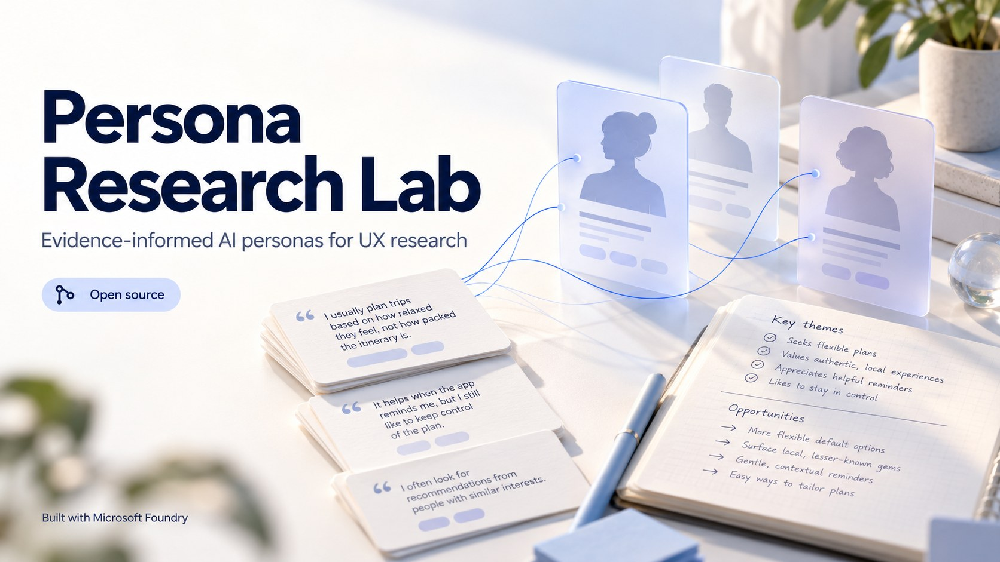
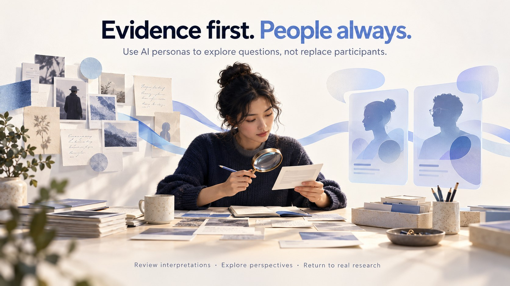

# Persona Research Lab



An open-source Microsoft Foundry starter project by **Ramy Hammady** for qualitative UX analysis and evidence-informed persona agents.

**Prototype v0.1.** The offline test suite passes; live Azure execution and researcher usability have not been validated in this development environment. AI-generated interpretations require review. Simulated persona responses are never participant data.

## The idea



Turn anonymised qualitative excerpts into provisional themes and behaviour-based personas. Review and edit the proposed interpretation, then ask a selected persona agent a question or compare the perspectives of all reviewed personas. Use the results to identify assumptions and plan follow-up research with real participants.

The illustrations are conceptual AI artwork, not screenshots. Any quotations or notes depicted in the cover are fictional decoration and are not research evidence.

## What you can do

| Stage | Function | Researcher responsibility |
|---|---|---|
| Evidence | Add 2–60 anonymised records with stable source IDs | Establish permission, context and data quality |
| Analysis | Propose themes, exact excerpts and 1–3 personas | Assess interpretation, contradictions and missing perspectives |
| Review | Edit the JSON and approve the profiles | Check every material assertion against source context |
| Persona exploration | Ask one persona or compare all profiles | Treat responses as simulated interpretations or unknowns |
| Export | Download evidence, analysis and simulations as JSON or Markdown | Keep exports in an authorised location |

Live outputs can be requested in English or Arabic. Source excerpts are preserved verbatim in their original language. The fixed demo is English-only. Arabic interpretation quality needs human review.

## Quick start: no Azure account needed

Install Python 3.11 or newer, open a terminal in this folder and run:

```sh
python app.py
```

Open **http://127.0.0.1:8081**.

1. Click **Load fictional sample**.
2. Click **Propose themes and personas**.
3. Review the themes, source excerpts, needs, unknowns and conflicting preferences.
4. Optionally edit the analysis JSON and click **Apply edits and review again**.
5. Check the review acknowledgement.
6. Type a question and ask one persona or compare both demo personas.
7. Export the record.

Demo mode uses fixed, explicitly fictional data and responses. It makes no model calls and rejects other evidence so that a template cannot be mistaken for analysis of your own study. The sample is an invented energy-installation service with different customer and field-surveyor needs. It is not derived from a real study or the author's research participants.

## Connect Microsoft Foundry

Deploy an Azure OpenAI text model supporting the Responses API. Obtain your resource endpoint, deployment name and API key. In Bash or zsh:

```sh
export FOUNDRY_ENDPOINT='https://YOUR-RESOURCE.openai.azure.com/openai/v1'
export FOUNDRY_DEPLOYMENT='YOUR-DEPLOYMENT-NAME'
read -s -p 'Azure API key: ' FOUNDRY_API_KEY; echo
export FOUNDRY_API_KEY
python app.py
```

The `read -p` prompt syntax above is for Bash; in zsh use `read -s 'FOUNDRY_API_KEY?Azure API key: '; echo`. In PowerShell set the corresponding `$env:` variables securely in your local environment. Never commit credentials or paste keys into GitHub or chat. `.env.example` is documentation; this app does not automatically load `.env` files.

The alternative resource endpoint `https://YOUR-RESOURCE.services.ai.azure.com/openai/v1` is accepted. Set the **deployment name**, not an assumed model identifier. Select **Live**, confirm you are authorised to transmit the anonymised records, and run analysis.

This app uses standard-library HTTPS REST requests to `/openai/v1/responses`, with the deployment in `model`, role instructions in `instructions` and data as JSON in `input`. No third-party Python dependencies are required. Models must return the specified JSON; malformed, incomplete or invalid outputs are rejected. There is no automatic repair or retry that would create another billable call.

Microsoft recommends Entra ID authentication. This prototype uses an API key held on the local server. Add identity-based authentication and a production application boundary before hosting. Project-scoped endpoints, sovereign cloud domains and Foundry-hosted agent resources are not implemented in v0.1.

## How the agents work

These are application-orchestrated, role-configured model calls. They are not autonomous agents and are not persisted in Foundry Agent Service.

- **Analyst role:** one call proposes source-linked themes and persona profiles.
- **Human review:** the researcher edits and approves the analysis; applying edits performs local structural and evidence checks without a model call.
- **Persona role:** one independent call per selected profile, supplied with that profile and only its linked source records. There is no cross-persona conversation or shared conversational memory.
- **Comparison:** the app displays up to three independent persona responses side by side. It does not run a vote, calculate population preferences or merge responses into findings.

Each question is stateless and independent. Comparison uses up to three sequential requests with a 90-second timeout each. A later failed request can leave earlier Azure calls billable even though the comparison is not displayed. Token usage returned by successful calls is included in exports. No browsing, external retrieval, tool execution or actions are available to the model.

## Evidence integrity and limits

The server checks that cited IDs exist, persona citations remain within the reviewed profile's sources, and quoted text is an exact substring of the cited source. Evidence fingerprints detect source changes after analysis. The interface resets approval when source settings or analysis text changes. The review acknowledgement is a local workflow step, not an authenticated approval record or tamper-proof audit trail.

These mechanical checks **do not establish semantic support**, reliable interpretation or representativeness. A model can still misinterpret a genuine excerpt, overgeneralise, omit contradictory material or reproduce bias. Demographics are not requested; personas focus on needs and behaviours. Do not use generated personas to impersonate actual participants or count simulated answers as interviews, validation, saturation or study findings.

Source IDs identify records, not necessarily unique people. Researchers should keep their own consent records, participant mapping, study context and analytic decisions. This application is a starting point for exploring interpretations, not a complete qualitative analysis methodology.

## Data handling

The browser sends evidence to a Python server bound to `127.0.0.1`. Live mode then sends it to the configured Azure resource. Credentials remain on the server. The app does not log request content or write evidence/results to disk; the browser holds the current session until refresh. Downloads explicitly include supplied source content. No automatic anonymisation is performed.

`store: false` requests no Responses application-state storage. It does not guarantee zero retention across Azure service logging or abuse-monitoring systems. Review your organisation's consent, Azure configuration and data policies before submitting research material. This server is for local development only: it has no user authentication, database, encryption-at-rest layer or multi-user access model. Do not expose it to the internet.

## Verification

```sh
python -m unittest discover -s tests -v
```

The 18 offline tests cover source IDs, exact quotations, persona source boundaries, review requirements, evidence changes, invalid model output, endpoint restrictions, request construction, demo operation and HTTP routes. JavaScript syntax is also checked during development. The tests do not measure research validity or live model quality. CI runs the Python suite on 3.11 and 3.12.

See [the evaluation guide](docs/EVALUATION.md) before assessing this prototype with your own data.

## Files

- `app.py`: local HTTP server, same-origin checks and bounded requests
- `core.py`: analyst/persona prompts, orchestration and source validation
- `foundry.py`: Microsoft Foundry REST integration
- `static/`: browser interface
- `examples/`: fictional evidence and fixed demo analysis
- `tests/`: offline unit and HTTP integration tests
- `docs/images/`: cover, concept illustration and generation prompts

## Official integration references

- [Azure OpenAI Responses API](https://learn.microsoft.com/en-us/azure/foundry/openai/how-to/responses)
- [Responses REST reference](https://learn.microsoft.com/en-us/rest/api/aifoundry/azureopenai/responses)

Integration references checked 4 October 2026. Model and regional availability depend on your Azure resource. No Microsoft endorsement is claimed.

## Licence and contribution

MIT; see [LICENSE](LICENSE). Contributions are welcome; see [CONTRIBUTING.md](CONTRIBUTING.md). Please keep fictional demos separate from participant evidence and report evaluation results honestly.
